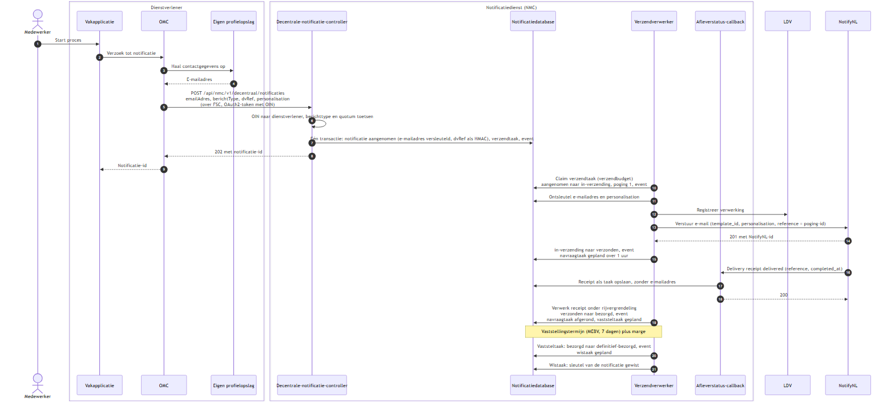
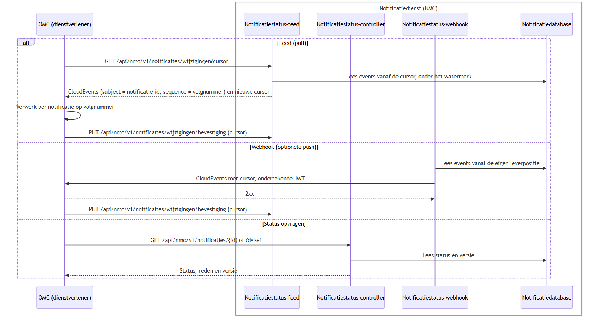
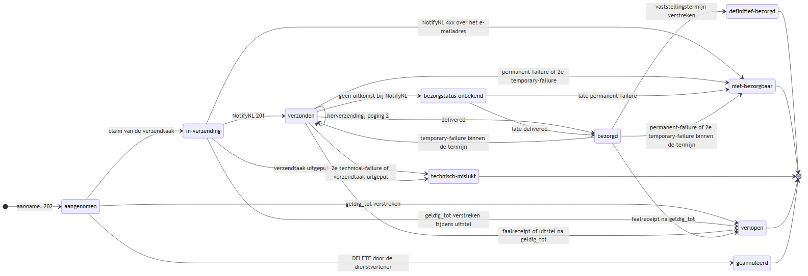
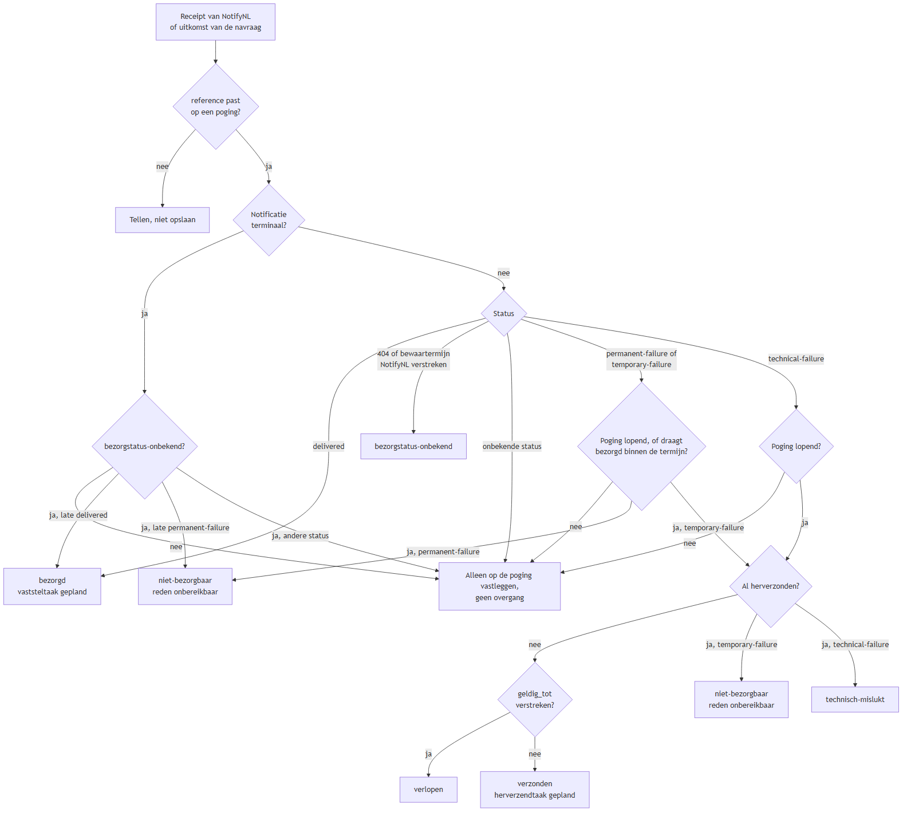

## Verloop van een decentrale notificatie

Dit hoofdstuk laat in diagrammen zien hoe één notificatie bij gedecentraliseerde regie door de Notificatiedienst loopt, van de aanname tot de terugkoppeling. De dienstverlener levert het e-mailadres zelf aan; het NMC raadpleegt de Profielservice niet en meldt een ongeldig adres niet terug. De diagrammen volgen het ontwerp uit [ADR 0024](/workspace/decisions#24); hoofdstuk 6 beschrijft welke onderdelen al gebouwd zijn.

### Aanname, verzending en bezorging

Het verloop bij een geslaagde aflevering. De aanname is synchroon; alles daarna loopt via taken in de notificatiedatabase, die de Verzendverwerker claimt en uitvoert.



<details>
    <summary>Zie Mermaid code</summary>

    ```mermaid
    sequenceDiagram
        autonumber
        actor Medewerker
        box Dienstverlener
            participant Vakapplicatie
            participant OMC
            participant Profiel as Eigen profielopslag
        end
        box Notificatiedienst (NMC)
            participant Intake as Decentrale-notificatie-controller
            participant DB as Notificatiedatabase
            participant Worker as Verzendverwerker
            participant Callback as Afleverstatus-callback
        end
        participant LDV
        participant NotifyNL

        Medewerker->>Vakapplicatie: Start proces
        Vakapplicatie->>OMC: Verzoek tot notificatie
        OMC->>Profiel: Haal contactgegevens op
        Profiel-->>OMC: E-mailadres
        OMC->>Intake: POST /api/nmc/v1/decentraal/notificaties<br/>emailAdres, berichtType, dvRef, personalisation<br/>(over FSC, OAuth2-token met OIN)
        Intake->>Intake: OIN naar dienstverlener, berichttype en quotum toetsen
        Intake->>DB: Eén transactie: notificatie aangenomen (e-mailadres versleuteld, dvRef als HMAC), verzendtaak, event
        Intake-->>OMC: 202 met notificatie-id
        OMC-->>Vakapplicatie: Notificatie-id

        Worker->>DB: Claim verzendtaak (verzendbudget)<br/>aangenomen naar in-verzending, poging 1, event
        Worker->>DB: Ontsleutel e-mailadres en personalisation
        Worker->>LDV: Registreer verwerking
        Worker->>NotifyNL: Verstuur e-mail (template_id, personalisation, reference = poging-id)
        NotifyNL-->>Worker: 201 met NotifyNL-id
        Worker->>DB: in-verzending naar verzonden, event<br/>navraagtaak gepland over 1 uur

        NotifyNL->>Callback: Delivery receipt delivered (reference, completed_at)
        Callback->>DB: Receipt als taak opslaan, zonder e-mailadres
        Callback-->>NotifyNL: 200
        Worker->>DB: Verwerk receipt onder rijvergrendeling<br/>verzonden naar bezorgd, event<br/>navraagtaak afgerond, vaststeltaak gepland
        Note over Worker,DB: Vaststellingstermijn (MEBV, 7 dagen) plus marge
        Worker->>DB: Vaststeltaak: bezorgd naar definitief-bezorgd, event<br/>wistaak gepland
        Worker->>DB: Wistaak: sleutel van de notificatie gewist
    ```

</details>

Elke overgang schrijft in dezelfde transactie een event in het eventlog. Die events zijn de bron voor de terugkoppeling hieronder. Een tweede aanname met dezelfde `dvRef` en dezelfde inhoud levert dezelfde notificatie-id op en start geen tweede verzending.

### Terugkoppeling aan de dienstverlener

De dienstverlener kiest zelf hoe hij de afleverstatus ophaalt. De feed en de status-query werken altijd; de webhook alleen als de dienstverlener er bij onboarding een heeft geregistreerd. Alleen de bevestiging van de feedcursor telt als ontvangen, ook bij de webhook.



<details>
    <summary>Zie Mermaid code</summary>

    ```mermaid
    sequenceDiagram
        participant OMC as OMC (dienstverlener)
        box Notificatiedienst (NMC)
            participant Feed as Notificatiestatus-feed
            participant Status as Notificatiestatus-controller
            participant Webhook as Notificatiestatus-webhook
            participant DB as Notificatiedatabase
        end

        alt Feed (pull)
            OMC->>Feed: GET /api/nmc/v1/notificaties/wijzigingen?cursor=
            Feed->>DB: Lees events vanaf de cursor, onder het watermerk
            Feed-->>OMC: CloudEvents (subject = notificatie-id, sequence = volgnummer) en nieuwe cursor
            OMC->>OMC: Verwerk per notificatie op volgnummer
            OMC->>Feed: PUT /api/nmc/v1/notificaties/wijzigingen/bevestiging (cursor)
        else Webhook (optionele push)
            Webhook->>DB: Lees events vanaf de eigen leverpositie
            Webhook->>OMC: CloudEvents met cursor, ondertekende JWT
            OMC-->>Webhook: 2xx
            OMC->>Feed: PUT /api/nmc/v1/notificaties/wijzigingen/bevestiging (cursor)
        else Status opvragen
            OMC->>Status: GET /api/nmc/v1/notificaties/{id} of ?dvRef=
            Status->>DB: Lees status en versie
            Status-->>OMC: Status, reden en versie
        end
    ```

</details>

### Statussen van een decentrale notificatie

De statussen van de notificatie en de overgangen die bij gedecentraliseerde regie kunnen optreden. Ten opzichte van het volledige model in hoofdstuk 7 ontbreekt `geen-contactgegevens`: die reden komt alleen van de Profielservice.



<details>
    <summary>Zie Mermaid code</summary>

    ```mermaid
    stateDiagram-v2
        direction LR
        state "in-verzending" as in_verzending
        state "niet-bezorgbaar" as niet_bezorgbaar
        state "technisch-mislukt" as technisch_mislukt
        state "bezorgstatus-onbekend" as bezorgstatus_onbekend
        state "definitief-bezorgd" as definitief_bezorgd
        [*] --> aangenomen : aanname, 202
        aangenomen --> in_verzending : claim van de verzendtaak
        aangenomen --> geannuleerd : DELETE door de dienstverlener
        aangenomen --> verlopen : geldig_tot verstreken
        in_verzending --> verzonden : NotifyNL 201
        in_verzending --> niet_bezorgbaar : NotifyNL 4xx over het e-mailadres
        in_verzending --> technisch_mislukt : verzendtaak uitgeput
        in_verzending --> verlopen : geldig_tot verstreken tijdens uitstel
        verzonden --> verzonden : herverzending, poging 2
        verzonden --> bezorgd : delivered
        verzonden --> niet_bezorgbaar : permanent-failure of 2e temporary-failure
        verzonden --> technisch_mislukt : 2e technical-failure of verzendtaak uitgeput
        verzonden --> verlopen : faalreceipt of uitstel na geldig_tot
        verzonden --> bezorgstatus_onbekend : geen uitkomst bij NotifyNL
        bezorgstatus_onbekend --> bezorgd : late delivered
        bezorgstatus_onbekend --> niet_bezorgbaar : late permanent-failure
        bezorgd --> definitief_bezorgd : vaststellingstermijn verstreken
        bezorgd --> verzonden : temporary-failure binnen de termijn
        bezorgd --> niet_bezorgbaar : permanent-failure of 2e temporary-failure binnen de termijn
        bezorgd --> verlopen : faalreceipt na geldig_tot
        definitief_bezorgd --> [*]
        niet_bezorgbaar --> [*]
        technisch_mislukt --> [*]
        verlopen --> [*]
        geannuleerd --> [*]
    ```

</details>

### Verwerking van een receipt

Hoe het NMC een delivery receipt of de uitkomst van de afleverstatus-navraag vertaalt naar een overgang. Een notificatie krijgt in totaal één herverzending, ongeacht de faalsoort. Bij gedecentraliseerde regie volgt op `permanent-failure` geen melding bij de Profielservice; de opvolging ligt bij de dienstverlener.



<details>
    <summary>Zie Mermaid code</summary>

    ```mermaid
    flowchart TD
        R["Receipt van NotifyNL<br/>of uitkomst van de navraag"] --> P{"reference past<br/>op een poging?"}
        P -- nee --> X["Tellen, niet opslaan"]
        P -- ja --> T{"Notificatie<br/>terminaal?"}
        T -- ja --> U{"bezorgstatus-onbekend?"}
        U -- nee --> V["Alleen op de poging vastleggen,<br/>geen overgang"]
        U -- "ja, late delivered" --> B
        U -- "ja, late permanent-failure" --> NB1
        U -- "ja, andere status" --> V
        T -- nee --> S{"Status"}
        S -- delivered --> B["bezorgd<br/>vaststeltaak gepland"]
        S -- "404 of bewaartermijn<br/>NotifyNL verstreken" --> O["bezorgstatus-onbekend"]
        S -- onbekende status --> V
        S -- "permanent-failure of<br/>temporary-failure" --> L{"Poging lopend, of draagt<br/>bezorgd binnen de termijn?"}
        S -- technical-failure --> LT{"Poging lopend?"}
        L -- nee --> V
        L -- "ja, permanent-failure" --> NB1["niet-bezorgbaar<br/>reden onbereikbaar"]
        L -- "ja, temporary-failure" --> H{"Al herverzonden?"}
        LT -- nee --> V
        LT -- ja --> H
        H -- nee --> G{"geldig_tot<br/>verstreken?"}
        G -- ja --> VL["verlopen"]
        G -- nee --> HV["verzonden<br/>herverzendtaak gepland"]
        H -- "ja, temporary-failure" --> NB2["niet-bezorgbaar<br/>reden onbereikbaar"]
        H -- "ja, technical-failure" --> TM["technisch-mislukt"]
    ```

</details>

De enige terminale status die nog een overgang toelaat is `bezorgstatus-onbekend`: een late `delivered` of `permanent-failure` brengt de notificatie alsnog naar `bezorgd` of `niet-bezorgbaar`.

Komt er geen receipt, dan vraagt de afleverstatus-navraag de status bij NotifyNL op na 1, 6 en 24 uur en daarna dagelijks tot de bewaartermijn van NotifyNL. Een fout in de aanroep zelf (401, 403, 429, 5xx, time-out) kost de notificatie geen poging: de taak wordt uitgesteld en herhaald tot `geldig_tot`.
